<!--
  Profile README for github.com/BEAST04289
  Artwork ......... python scripts/build_static.py   (edit the CONTENT block, re-run, commit)
  Live stats ...... .github/workflows/profile-stats.yml (daily) -> assets/stats/ + profile-3d-contrib/
  Snake ........... .github/workflows/snake.yml (daily) -> `output` branch
-->


&nbsp;
&nbsp;

 

AI engineer in the making — I build **AI agents** and **RAG systems**, plus the backend and cloud that ship them.
Second-year Computer Science undergrad at **Manipal University Jaipur**.

> [!TIP]
> **Open to AI/ML and Software Engineering internships.** Reach me at [shaurya04289@gmail.com](mailto:shaurya04289@gmail.com) or on [LinkedIn](https://www.linkedin.com/in/shaurya--upadhyay/).

 

Also: <b>McKinsey.org Forward Program</b> · <b>Google GEAR</b> — Gemini Enterprise Agent Ready · <b>25+ Google Cloud Skill Badges</b>

 

<a href="https://github.com/BEAST04289/SchemeBot"></a><a href="https://github.com/BEAST04289/iWEBIFY"></a>
<a href="https://github.com/BEAST04289/Sentinel"></a><a href="https://github.com/BEAST04289/AWS_AI-FOR-BHARAT"></a>
<a href="https://github.com/BEAST04289/CaseVera"></a><a href="https://github.com/BEAST04289/DugTrio"></a>

<b>More projects</b>

 

| Project | What it is | Built with |
|:--|:--|:--|
| [**N100 Financial Intelligence**](https://github.com/BEAST04289/N100-Financial-Intelligence) | Analytics platform for the Nifty 100 — 92 companies, 50+ KPIs, 16 API endpoints | Python · FastAPI · Streamlit |
| [**VERITAS.AI**](https://github.com/BEAST04289/VERITAS.AI) | Generative-AI video detector built on physics checks | TypeScript · Python |
| [**Avsarathi.ai**](https://github.com/BEAST04289/Avsarathi.ai) | WhatsApp-first scheme matching for NSFDC credit schemes · Smart India Hackathon 2026 | FastAPI · LangGraph · Gemini |
| [**pre-dispatch-returns-risk**](https://github.com/BEAST04289/pre-dispatch-returns-risk) | Leakage-safe return-risk scoring with chronological validation | Python · FastAPI |
| [**AI-IMAGE-GEN**](https://github.com/BEAST04289/AI-IMAGE-GEN) | Serverless AI image editor | AWS Bedrock · Lambda |

🟢 <a href="https://casevera.vercel.app"><b>CaseVera live snapshot</b></a> &nbsp;·&nbsp; <a href="https://github.com/BEAST04289?tab=repositories">all repositories →</a>

 


 

<table>
<tr>
<td width="50%" valign="top">

### 📊 Data Analyst Intern
**Bluestock Fintech** · Remote · Jul – Sep 2026

- 🥇 Ranked **#1 of 28,017** on a live-proctored assessment (top 0.004%), scoring **100/100 in under 10 minutes** across SQL, Python/Pandas, statistics and business cases
- Built an end-to-end **Mutual Fund Analytics Platform** for 40 funds: ETL, investor cohorts, risk-appetite recommendations, and Sharpe, Sortino, VaR/CVaR, max drawdown, alpha and beta
- Shipped a 4-page **Streamlit + Plotly** dashboard (scorecards, SIP vs. Nifty 50, T30/B30) on a resumable ETL pipeline with step-level checkpoints and pytest

### 🎓 Manipal University Jaipur
**B.Tech, Computer Science & Engineering** · CGPA **8.12/10** · expected May 2029

Coursework: data structures & algorithms · OOP · DBMS · probability & statistics

</td>
<td width="50%" valign="top">

### 🛡️ Open Source Contributor
**OWASP OpenCRE** (OWASP flagship project) · Mar – Jul 2026

- Merged [**#837**](https://github.com/OWASP/OpenCRE/pull/837): fixed a production crash caused by variable shadowing in `get_by_tags()` and added a regression test, through maintainer review and CI
- Merged [**#993**](https://github.com/OWASP/OpenCRE/pull/993): an 11-file code-quality pass plus a fix for a CodeQL-flagged **open redirect**, using HTTPS allowlisting and URL-scheme validation

### 🌐 WikiTech: Road to Wiki — Cohort 2
**Wikimedia Foundation** · Jan 2026 – present

- Selected among the **top 100 students nationally**; contributing to production Wikimedia tools through the Gerrit code-review workflow

</td>
</tr>
</table>

 

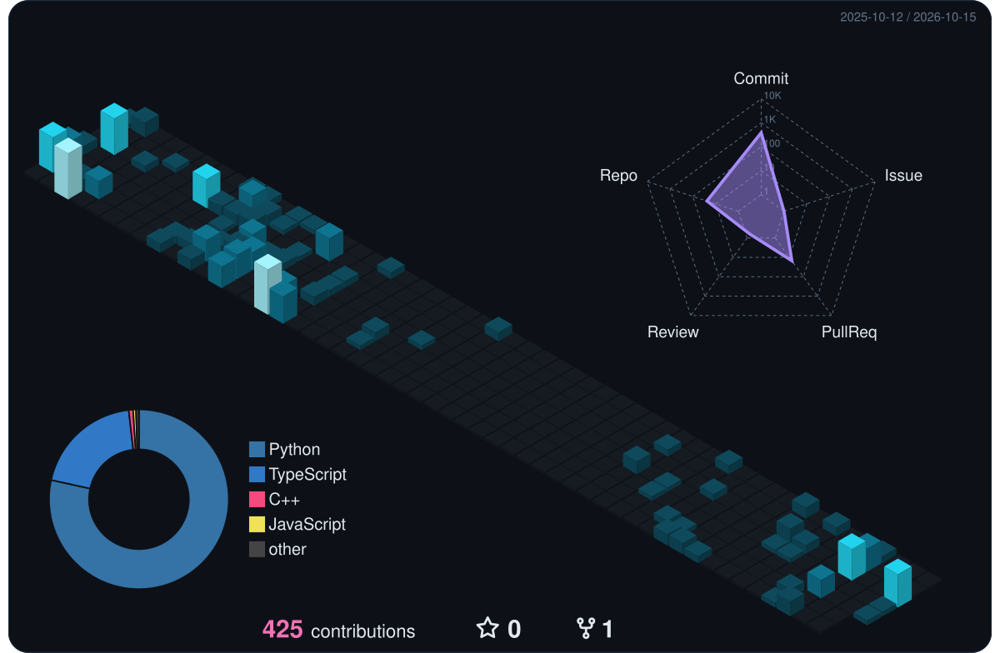
<picture>
  <source media="(prefers-color-scheme: dark)" srcset="https://raw.githubusercontent.com/BEAST04289/BEAST04289/output/snake-dark.svg"/>
  <source media="(prefers-color-scheme: light)" srcset="https://raw.githubusercontent.com/BEAST04289/BEAST04289/output/snake-light.svg"/>
  
</picture>

